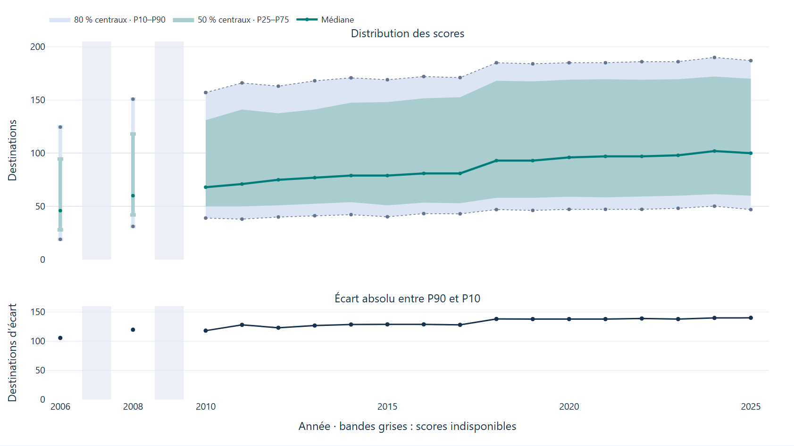
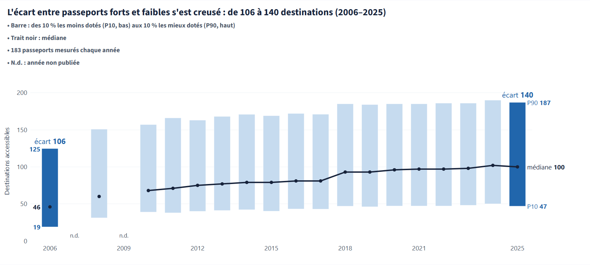

<style>
@page { size: A4; margin: 11mm 13mm 12mm; }
@page { @bottom-right { content: "Journal de bord · page " counter(page) " / 3"; font: 7.5pt "Segoe UI", Arial, sans-serif; color: #6B7A8F; } }
body { font-family: "Segoe UI", Arial, sans-serif; color: #17233B; font-size: 9.2pt; line-height: 1.3; margin: 0; }
h1 { font-size: 19pt; color: #FFFFFF; margin: 0; line-height: 1.15; }
h2 { font-size: 12.5pt; color: #1F4E8C; margin: 14pt 0 8pt; padding: 3pt 0 3pt 8pt; border-left: 4pt solid #1F4E8C; background: #EEF3F9; }
p { margin: 7pt 0; }
strong { color: #10203A; }
code { font-family: Consolas, monospace; font-size: 8.4pt; background: #EEF3F9; padding: 0 2pt; border-radius: 2pt; }
pre { font-size: 7.6pt; line-height: 1.18; white-space: pre-wrap; overflow-wrap: anywhere; background: #F6F8FB; border: 1px solid #DCE3EC; border-left: 3pt solid #8FA9C8; padding: 6pt 8pt; margin: 4pt 0 9pt; border-radius: 3pt; }
pre code { background: none; padding: 0; font-size: inherit; }
table { width: 100%; border-collapse: collapse; font-size: 8pt; line-height: 1.25; margin: 7pt 0 9pt; }
th, td { border-bottom: 1px solid #DCE3EC; padding: 3.2pt 5pt; vertical-align: top; text-align: left; }
th { background: #1F4E8C; color: #FFFFFF; font-weight: 600; }
tr:nth-child(even) td { background: #F6F8FB; }
img { display: block; width: 100%; max-height: 76mm; object-fit: contain; margin: 7pt auto 3pt; border: 1px solid #DCE3EC; border-radius: 3pt; }
.note { font-size: 7.8pt; color: #4A596D; font-style: italic; margin: 3pt 0 9pt; }
.cover { background: #1F4E8C; color: #FFFFFF; padding: 9pt 12pt 8pt; border-radius: 4pt; }
.cover .eyebrow { font-size: 7.8pt; letter-spacing: .08em; text-transform: uppercase; color: #BFD3EA; margin: 0 0 3pt; }
.meta { display: grid; grid-template-columns: repeat(4, 1fr); gap: 4pt; margin: 7pt 0 0; font-size: 7.8pt; }
.meta div { background: rgba(255,255,255,.12); border-radius: 3pt; padding: 3pt 5pt; color: #FFFFFF; }
.meta b { display: block; font-size: 6.8pt; text-transform: uppercase; letter-spacing: .06em; color: #BFD3EA; }
.meta a { color: #FFFFFF; }
.callout { background: #FFF6EC; border-left: 4pt solid #C25E00; padding: 5pt 8pt; margin: 9pt 0 9pt; font-size: 10pt; border-radius: 0 3pt 3pt 0; }
.cards { display: grid; grid-template-columns: repeat(3, 1fr); gap: 6pt; margin: 9pt 0; }
.cards div { border: 1px solid #DCE3EC; border-top: 3pt solid #1F4E8C; border-radius: 3pt; padding: 4pt 6pt; font-size: 8.4pt; }
.cards b { display: block; color: #1F4E8C; font-size: 8pt; text-transform: uppercase; letter-spacing: .05em; margin-bottom: 1pt; }
.tag { display: inline-block; font-weight: 700; font-size: 7.4pt; padding: 0.5pt 5pt; border-radius: 8pt; color: #FFFFFF; }
.keep { background: #1F6E43; } .edit { background: #1F4E8C; } .drop { background: #C25E00; }
.stats { display: grid; grid-template-columns: repeat(3, 1fr); gap: 6pt; margin: 9pt 0; }
.stats div { background: #EEF3F9; border-radius: 3pt; padding: 4pt 7pt; font-size: 8pt; color: #4A596D; }
.stats b { display: block; font-size: 14pt; color: #1F4E8C; line-height: 1.15; }
.label { font-size: 7.6pt; font-weight: 700; color: #4A596D; text-transform: uppercase; letter-spacing: .06em; margin: 9pt 0 2pt; }
</style>

<div class="cover">
<p class="eyebrow">Journal de bord analytique · M2 MIAGE Dauphine 2026–2027</p>
<h1>Passeports : une hiérarchie de la mobilité ?</h1>
<div class="meta">
<div><b>Groupe</b>Raphaël, Florent, Mao, Capucine</div>
<div><b>Données</b>Henley Passport Index · TidyTuesday 2025-09-09</div>
<div><b>Application</b>Python · Streamlit + Plotly · Docker</div>
<div><b>Dépôt</b><a href="https://github.com/Florentjin/Datavis">github.com/Florentjin/Datavis</a></div>
</div>
</div>

## 1. Prompt initial et contexte

<div class="callout"><strong>Problématique.</strong> Le régime mondial des visas organise-t-il une hiérarchie de la mobilité : qui peut circuler, qui accueille, et selon quelles réciprocités ?</div>

<div class="cards">
<div><b>Destinataires</b>Analystes en relations internationales, journalistes de données, décideurs publics.</div>
<div><b>Intention</b><em>Communiquer un constat</em> chiffré sur les inégalités de mobilité, sans prescrire ni attribuer de cause.</div>
<div><b>Format</b>Application Python interactive (Streamlit + Plotly), en local ou par Docker.</div>
</div>

**Deux questions analytiques, quatre vues chacune.** Conformément à la limite de 2 à 4 questions, l'application répond à *Qui peut voyager ?* (scores 2006–2025, Q1–Q4) et à *Qui accueille, et à quelles conditions ?* (listes 2025, Q5–Q8). Chaque vue sert une seule tâche (séance 4, diapo 6) : distribution, évolution, classement, parties d'un tout ; réciprocité, corrélation, matrice, comparaison.

**Provenance.** Le groupe ne disposait que d'une capture historique de quatre graphiques, sans prompt ni code. Nous avons donc soumis puis conservé une nouvelle demande, reproduite à l'identique :

<p class="label">Prompt soumis à l'IA (verbatim)</p>

```text
Tu es un consultant en analyse et visualisation de données. Propose un premier
prototype Python pour un dashboard analytique du Henley Passport Index,
TidyTuesday 2025-09-09. Le public comprend des analystes en relations
internationales, journalistes de données et décideurs publics. La question est :
comment les inégalités de mobilité associées aux passeports ont-elles évolué
entre 2006 et 2025, selon les pays et les régions ?

Deux fichiers locaux sont disponibles : rank_by_year.csv (code, country, region,
rank, visa_free_count, year) et country_lists.csv (code, country et cinq listes
JSON de destinations : visa_required, visa_online, visa_on_arrival,
visa_free_access, electronic_travel_authorisation).

Produis une première proposition autonome de quatre graphiques complémentaires
en pandas et Plotly, avec messages, encodages et limites. Lis et examine les
données avant de proposer les traitements ; n'invente pas d'observation ni
d'explication causale. Un prototype HTML local statique suffit pour cette
itération, l'interactivité coordonnée viendra dans le produit final.

Conserve ta réponse dans docs/reponse_iteration_01.md et le script dans
prototype_ia.py. Le script doit produire livrables/proposition_ia.html à partir
des CSV locaux, sans API ni CDN. Ne modifie aucun fichier source de données.
N'introduis pas intentionnellement de défaut : l'audit pourra conserver,
modifier ou rejeter des choix réellement présents dans ta proposition.
```

**Variables transmises.** `rank_by_year.csv` : 3 950 observations, 199 passeports, 7 régions Henley, 2006–2025. `country_lists.csv` : 199 passeports × 227 destinations, photographie 2025 sans historique. Le score Henley compte les destinations sans visa, avec visa à l'arrivée ou avec autorisation électronique (ETA) ; le e-visa en est exclu. La source contient 447 scores nuls, dont toutes les valeurs de 2007 et 2009 : nous les traitons comme manquants. Le score ne mesure ni les voyages effectifs, ni leur coût.

<div style="page-break-before: always;"></div>

## 2. Proposition brute de l'IA

L'IA a produit quatre figures : *Monde* (distribution annuelle), *Régions* (sept petits multiples), *Pays* (score 2006 contre variation) et *Conditions d'entrée* (barres empilées). Elles sont archivées sans retouche dans `docs/reponse_iteration_01.md`, `prototype_ia.py` et `livrables/proposition_ia.html`. Ci-dessous, la figure *Monde* brute :



<p class="note">Capture de la figure Monde de la proposition 01. Rubans P10–P90 et P25–P75, médiane, second panneau de l'écart P90–P10 ; bandes grises pour 2007 et 2009.</p>

## 3. Audit et critique visuelle

| Constat sur la proposition de l'IA | Principe du cours | Arbitrage |
|---|---|---|
| Panel constant de 183 passeports, scores nuls écartés, années manquantes visibles et non reliées, code `NA` (Namibie) protégé. | Données manquantes visibles (S3 d. 49) | <span class="tag keep">Conservé</span> |
| L'écart P90–P10 est encodé deux fois : largeur du ruban et second panneau. | Encodage redondant inutile (S3 d. 21–23) | <span class="tag edit">Modifié</span> une barre P10–P90 par année, écart écrit |
| Deux rubans imbriqués et une légende à décoder ; titre descriptif « Distribution des scores ». | Data-ink, légende (S3 d. 20) ; le titre et le sous-titre guident (S3 d. 14–15) | <span class="tag edit">Modifié</span> P25–P75 et légende retirés, titre = réponse, sous-titre = clé de lecture |
| Aucune valeur écrite ; une seule teinte pour tout le graphique. | Couleur avec intention, mise en évidence (S2 d. 38, 48) ; annotations (S4 d. 11) | <span class="tag edit">Modifié</span> contexte pâle, 2006 et 2025 foncés, P10, médiane et P90 écrits |
| *Pays* : la variable X (score 2006) entre dans le calcul de Y (variation) ; plus de 180 points colorés selon 7 régions. | Tâche top/flop (S4 d. 6) ; mémoire de travail de 5 à 9 éléments (S2 d. 4) | <span class="tag drop">Rejeté</span> 5 plus fortes et 5 plus faibles variations en barres à base zéro (Q3) |
| *Régions* : 7 panneaux séparés pour comparer 7 médianes. | Position sur une échelle commune (S2 d. 35) | <span class="tag edit">Modifié</span> un seul axe, une ligne par région, médiane marquée (Q1) |
| *Conditions* : 5 régimes empilés en effectifs ; les segments centraux n'ont pas d'origine commune. | Barres empilées (S5 d. 7–9) ; base 0 jusqu'à 100 % (S3 d. 42) | <span class="tag edit">Modifié</span> barres 100 %, deux familles de couleur, total écrit à droite (Q4) |
| Textes d'environ 12 px, illisibles une fois projetés. | Lisibilité, test des 5 secondes (S4 d. 11) | <span class="tag edit">Modifié</span> texte d'au moins 16 px, une question par écran 1080p |

<p class="note">S = séance, d. = diapositive des supports du cours. Registre complet : docs/audit_ia.md.</p>

<div style="page-break-before: always;"></div>

## 4. Arbitrage et version corrigée



<p class="note">Q2 finale, mêmes données que la figure Monde de l'IA. Une barre P10–P90 par année, médiane en trait noir, comparaison 2006/2025 mise en évidence, valeurs écrites, années non publiées signalées « n.d. » et jamais reliées.</p>

| Question | Tâche | Graphique retenu et choix principal |
|---|---|---|
| Q1 Répartition | Distribution | Points sur un axe commun, médiane par région, une seule teinte : la ligne nomme déjà la région |
| Q2 Évolution | Évolution | Barres P10–P90 et médiane ; 2006 et 2025 en couleur, le reste en contexte |
| Q3 Gagnants/perdants | Classement | Barres à base zéro, 5 + 5 pays, recul en orange (bleu/orange plutôt que vert/rouge, S2 d. 47) |
| Q4 Formalités | Parties d'un tout | Barres 100 %, bleus = sans démarche, orangés = visa ; total des bleus écrit à droite |
| Q5 Réciprocité | Parties d'un tout | Mêmes codes que Q4 (S3 d. 27), solde de réciprocité écrit |
| Q6 Accueil/puissance | Corrélation | Nuage en quatre quadrants, autres pays en gris, 7 pays commentés en bleu, r = 0,13 écrit |
| Q7 Entre régions | Matrice | Carte de chaleur séquentielle ; diagonale encadrée, verrou le plus fort en orange (alerte) |
| Q8 Clubs | Comparaison | Haltères « vers non-membres / entre membres », moyenne mondiale en référence |

**Deuxième itération assistée par IA : lisibilité en projection.** Une IA de code (GitHub Copilot) a audité les huit vues à 1920×1080 à partir des supports du cours. Nous avons **retenu** : la taille minimale de 16 px, la suppression des grilles et des légendes inutiles, et la réduction de Q3 de 10 à 5 pays par groupe. L'audit a aussi relevé que le message apparaissait trois fois (en-tête, titre, encadré « À retenir ») : il n'est plus énoncé qu'une fois, comme titre du graphique. Un test automatique vérifie la taille du texte et la hauteur de chaque graphique.

<div class="stats">
<div><b>106 → 140</b>destinations d'écart P90–P10 (2006 → 2025, 183 passeports)</div>
<div><b>6,56 → 3,98</b>rapport P90/P10 : les plus faibles progressent aussi</div>
<div><b>182 / 183</b>passeports progressent ; seule la Bolivie recule (83 → 78)</div>
</div>

**Résultats défendus.** L'écart absolu se creuse alors que l'écart relatif se resserre : nous montrons les deux. Un brouillon rédigé avec l'IA indiquait « Bolivie 82 → 77 » : l'erreur a été corrigée après retour au CSV.

**Limites.** Les régimes de 2025 ne donnent aucun historique. Chaque pays compte pour un, sans pondération par la population. Les écarts sont décrits, mais aucune cause n'est démontrée.

<p class="note"><strong>Sources :</strong> énoncé du projet (sections 4, 7, 8) ; TidyTuesday 2025-09-09 ; <a href="https://www.henleyglobal.com/passport-index/methodology">méthodologie Henley</a> ; supports des séances 2 à 5. Membres des organisations de Q8 : sites officiels (2025).</p>
