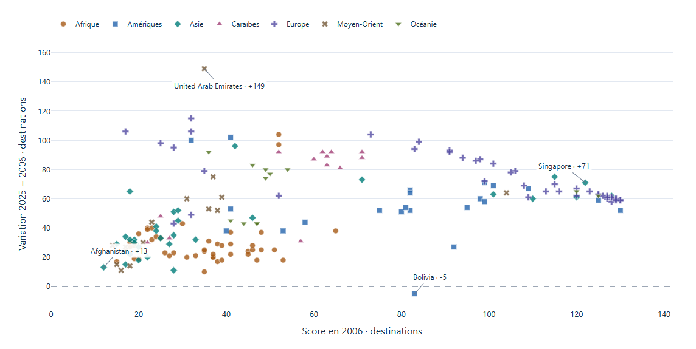
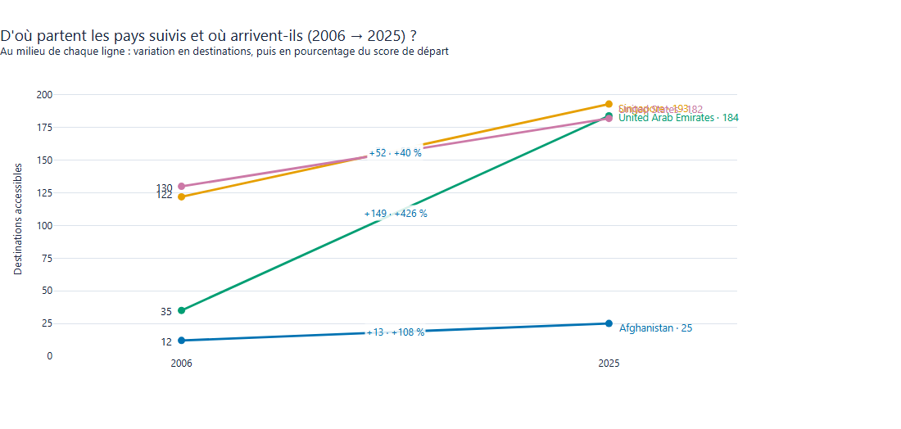

<style>
@page { size: A4; margin: 13mm; }
body { font-family: "Segoe UI", Arial, sans-serif; color: #17233B; font-size: 9.5pt; line-height: 1.25; }
h1 { font-size: 19pt; color: #224878; margin: 0 0 8pt; }
h2 { font-size: 13pt; color: #224878; margin: 12pt 0 6pt; }
h3 { font-size: 10.5pt; margin: 9pt 0 4pt; }
p { margin: 5pt 0; }
pre { font-size: 8pt; line-height: 1.17; white-space: pre-wrap; overflow-wrap: anywhere; background: #F3F6FA; padding: 9pt; }
table { width: 100%; border-collapse: collapse; font-size: 8.5pt; }
th, td { border: 1px solid #DCE3EC; padding: 5pt; vertical-align: top; }
th { background: #F3F6FA; text-align: left; }
img { max-width: 100%; max-height: 125mm; object-fit: contain; }
.note { font-size: 8pt; color: #4A596D; }
</style>

# Passeports et inégalités de mobilité

**Journal de bord analytique · M2 MIAGE · Groupe de quatre**

<p class="note">Version rédigée avec l'IA. Les membres doivent valider les arbitrages, renseigner leurs noms et compléter les références précises au cours. Aucune validation humaine n'est présumée.</p>

## 1. Prompt initial et contexte

**Question.** Comment les inégalités d'accès international se sont-elles reconfigurées entre 2006 et 2025, selon les régions et les pays ? Le public comprend des analystes, journalistes de données et décideurs publics. Le produit final est un dashboard Python, Streamlit et Plotly, organisé en quatre vues coordonnées.

**Provenance.** Le groupe disposait de deux CSV Henley, de leur documentation et d'une capture de quatre graphiques, sans code ni prompt conservé. Le contexte fourni ensuite n'a pas été authentifié comme prompt historique. Nous conservons donc cette image comme trace visuelle et documentons séparément une **nouvelle demande réellement soumise à l'IA**, reproduite ci-dessous.

```text
Tu es un consultant en analyse et visualisation de données. Propose un premier
prototype Python pour un dashboard analytique du Henley Passport Index,
TidyTuesday 2025-09-09. Le public comprend des analystes en relations
internationales, journalistes de données et décideurs publics. La question est :
comment les inégalités de mobilité associées aux passeports ont-elles évolué
entre 2006 et 2025, selon les pays et les régions ?

Deux fichiers locaux sont disponibles : rank_by_year.csv (code, country, region,
rank, visa_free_count, year) et country_lists.csv (code, country et cinq listes
JSON de destinations : visa_required, visa_online, visa_on_arrival,
visa_free_access, electronic_travel_authorisation).

Produis une première proposition autonome de quatre graphiques complémentaires
en pandas et Plotly, avec messages, encodages et limites. Lis et examine les
données avant de proposer les traitements ; n'invente pas d'observation ni
d'explication causale. Un prototype HTML local statique suffit pour cette
itération, l'interactivité coordonnée viendra dans le produit final.

Conserve ta réponse dans docs/reponse_iteration_01.md et le script dans
prototype_ia.py. Le script doit produire livrables/proposition_ia.html à partir
des CSV locaux, sans API ni CDN. Ne modifie aucun fichier source de données.
N'introduis pas intentionnellement de défaut : l'audit pourra conserver,
modifier ou rejeter des choix réellement présents dans ta proposition.
```

**Variables et définition.** L'historique contient 3 950 observations, 199 codes de passeports et sept régions. Le score Henley additionne les destinations sans visa, avec visa à l'arrivée et avec ETA selon sa méthode ; il exclut les e-visas à approbation préalable. Les listes bilatérales n'ont pas de dimension temporelle. Le score ne mesure ni des voyages effectifs, ni toutes les contraintes de mobilité.

<div style="page-break-before: always;"></div>

## 2. Proposition brute de l'IA

La nouvelle réponse et son code sont conservés sans les réécrire comme s'ils étaient le produit final : `docs/reponse_iteration_01.md`, `prototype_ia.py` et `livrables/proposition_ia.html`.

L'IA propose quatre figures : distribution mondiale annuelle et dispersion ; sept petits multiples régionaux ; score initial contre variation ; composition régionale des régimes d'entrée. Elle repère les scores nuls, conserve la Namibie (`NA`), utilise un panel historique constant et distingue écart absolu et rapport relatif. Ces bonnes décisions sont **conservées**, pas présentées comme des erreurs.



<p class="note">Capture recadrée de la figure Pays de la nouvelle proposition. X : score 2006 ; Y : variation 2025–2006. Ce choix est possible, mais le score initial intervient aussi dans le calcul de Y ; ce nuage ne démontre pas une convergence causale.</p>

## 3. Audit et critique visuelle

| Matériau et constat | Arbitrage et justification |
|---|---|
| **Image historique :** fausses chutes à zéro en 2007/2009 et gain de 128 pour le Monténégro. | Les 447 scores nuls sont mis à l'écart comme **anomalies présumées**, sans certification de leur statut par Henley. Calendrier complet et lacunes visibles ; comparaisons limitées aux scores exploitables aux deux dates. Intégrité des données avant storytelling. |
| **Nouvelle proposition :** précautions de nettoyage et indicateurs absolu/relatif déjà explicites. | Conserver. P90–P10 et P90/P10 peuvent évoluer en sens opposés : le choix de mesure doit rester visible et l'hypothèse de creusement ne doit pas être présupposée. |
| **Nouvelle proposition :** sept facettes et régimes empilés ; aucun filtre coordonné. | Recentrer quatre tâches : niveaux par région, trajectoires, départs et arrivées, gains et pertes. Déplacer l'instantané des visas dans une fiche. Réduire la charge cognitive et séparer histoire et instantané. |
| **Brouillon de restitution :** « Bolivie 82 → 77 », avec le bon delta −5. | Corriger en **83 → 78** après retour au CSV. La vérification des différences seules n'aurait pas détecté ces niveaux inexacts. |

<div style="page-break-before: always;"></div>

## 4. Arbitrage et version corrigée

Après un retour de lisibilité et la relecture des séances 3 et 4 du cours, les encodages ont été simplifiés : un seul encodage par donnée, des valeurs écrites sur la figure, des titres sous forme de question. Les médianes régionales sont reliées par deux points (gris au départ, coloré à l'arrivée) ; les trajectoires donnent une couleur et un nom par passeport, grisent les années sans donnée et stylent le mode rang en bump chart ; le diagramme de pente écrit chaque variation en destinations puis en pourcentage ; les barres autour de zéro opposent gains en bleu et reculs en orange.



<p class="note">Vue finale « Départs et arrivées », 2006–2025. Chaque ligne part du score initial et rejoint le score final ; au milieu, la variation en destinations puis en pourcentage du départ. Les couleurs reprennent celles des trajectoires ; les barres de la vue « Gains et pertes » classent les mêmes variations par amplitude.</p>

**Résultats sur le panel commun de 183 passeports.** Les Émirats passent de 35 à 184 destinations (+149). Les États-Unis passent de 130 à 182 (+52), mais du rang 1 au rang 10 : accès absolu et position relative divergent. La Bolivie passe de 83 à 78 (−5). Le Monténégro est exclu de cette comparaison faute de score initial interprétable.

**Nuance centrale.** P90–P10 passe de 105,6 à 140 destinations, tandis que P90/P10 passe de 6,56 à 3,98. Une augmentation de l'écart absolu n'est donc pas une aggravation de toutes les mesures d'inégalité. Chaque passeport a le même poids ; les résultats ne sont pas pondérés par la population.

**Limites et défense.** Les catégories régionales et la couverture historique sont celles de Henley. Les données ne prouvent aucune causalité diplomatique, économique ou sanitaire. L'instantané des listes est cohérent avec les scores 2025, sans date exacte de collecte ; une relation absente demeure inconnue. Le groupe doit défendre ces limites et ses choix d'encodage, pas seulement montrer le code.

<p class="note"><strong>Sources :</strong> énoncé local, sections 4, 7 et 8 ; documentation et CSV TidyTuesday du 09/09/2025 ; <a href="https://www.henleyglobal.com/passport-index/methodology">méthodologie Henley</a>. Registre détaillé : docs/audit_ia.md. Notions du cours (Séances 1 à 4, à vérifier par le groupe) : position pour la précision (S2 p. 36), échelles de couleurs et daltonisme bleu/orange (S2 p. 38–47), titre-question et sous-titre (S3 p. 14–15), un encodage par donnée (S3 p. 21–24), densité limitée (S3 p. 33–35), barres partant de zéro (S3 p. 40–42), manque visible sans interpolation (S3 p. 48–49 ; S4 p. 33), bump chart (S4 p. 21), diagramme de pente (S4 p. 25), écarts absolu et relatif (S4 p. 27–28).</p>
